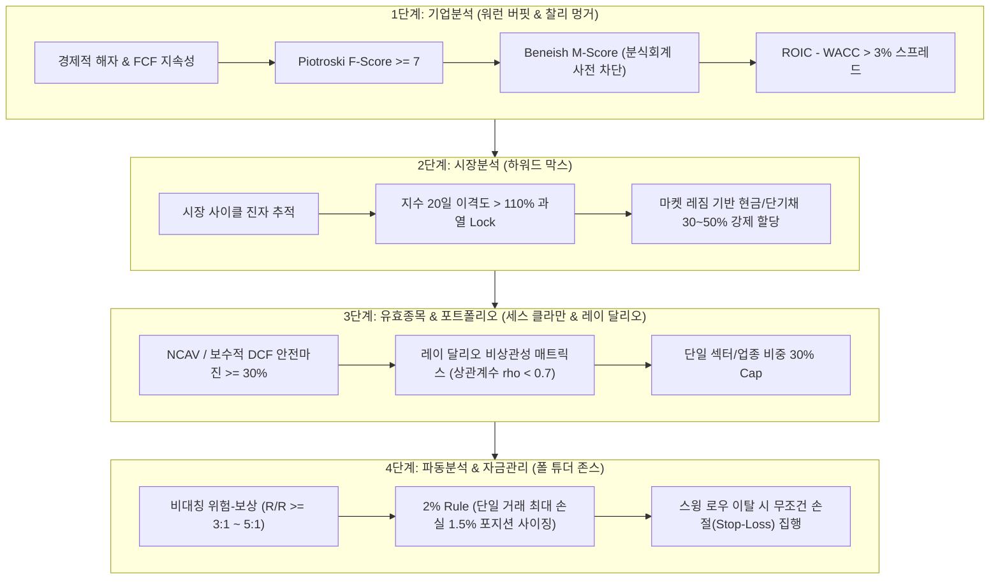

# 자본 보존형(Capital Preservation) 방어 시스템 아키텍처

> **"제1원칙: 절대로 돈을 잃지 마라. 제2원칙: 제1원칙을 절대로 잊지 마라."**  
> — 워런 버핏 (Warren Buffett)

본 시스템은 단순 수익률 추구형 모델에서 벗어나, 시장의 급락과 블랙스완 국면에서도 계좌의 최대 낙폭(MDD)을 방어하고 자본을 영구 보존하는 **4단계 자본 보존형 알고리즘 파이프라인**입니다.

---

## 1. 투자 대가들의 철학과 알고리즘 모듈 매핑

---

## 2. 단계별 정량 규칙 및 산출 수식

### 1단계: 기업분석 (워런 버핏 & 찰리 멍거)
- **ROIC vs WACC 스프레드**: $\text{ROIC} - \text{WACC} > 3\%$
  - 자본 비용 이상의 초과 영업이익을 5개년 연속 창출하는 경제적 해자(Moat) 기업 검증.
- **피오트로스키 F-Score (9점 만점 중 7점 이상)**:
  - 수익성(ROA, CFO > 0, $\Delta\text{ROA} > 0$, 발생액 분식 여부 $\text{CFO} > \text{ROA}$)
  - 재무구조(부채비율 감소, 유동비율 증가, 주식수 비희석)
  - 영업효율성(매출총이익률 증가, 자산회전율 증가)
- **베네이쉬 M-Score(Beneish M-Score)**:
  - $M > -1.78$인 기업은 분식회계 가능성으로 사전 전면 탈락.

### 2단계: 시장분석 (하워드 막스)
- **탐욕 극단값 역발상 필터 (Buy-Lock)**:
  - 코스피/코스닥 20일 이동평균 이격도 $> 110\%$ 또는 과열 레짐 감지 시 신규 매수 잠금(Lock).
- **현금 비중 강제 할당**:
  - 하락 국면/추세 이탈 시 전체 포트폴리오의 최소 30~50% 무위험 현금성 자산 보유 의무화.

### 3단계: 유효종목 & 분산 (세스 클라만 & 레이 달리오)
- **보수적 안전마진 (Margin of Safety >= 30%)**:
  $$\text{NCAV(순유동자산)} = \text{유동자산} - \text{총부채}$$
  $$\text{Safety Margin} = \frac{\text{NCAV 또는 보수적 DCF} - \text{현재 시가총액}}{\text{내재가치}} \ge 30\%$$
- **레이 달리오식 상관계수 매트릭스 필터**:
  - 포트폴리오 편입 종목 간 일간 수익률 상관계수 $\rho < 0.7$ 유지.
  - 단일 테마/업종(반도체, 2차전지, 제약 등) 비중 최대 30% 캡(Cap).

### 4단계: 파동분석 & 자금관리 (폴 튜더 존스)
- **최소 손익비(Risk/Reward Ratio >= 3.0 ~ 5.0)**:
  $$\text{Risk/Reward} = \frac{\text{목표가(파동 확장 1.618)} - \text{진입가}}{\text{진입가} - \text{손절가(스윙 로우)}} \ge 3.0$$
- **단일 거래 1.5% 위험 한도 (Position Sizing)**:
  $$\text{주문 수량} = \frac{\text{총 운용 자본} \times 0.015}{\text{진입가} - \text{손절가(스윙 로우)}}$$
- **원칙적 손절**: 진입의 근거가 된 스윙 로우 하향 이탈 시 감정 배제 무조건 청산.
